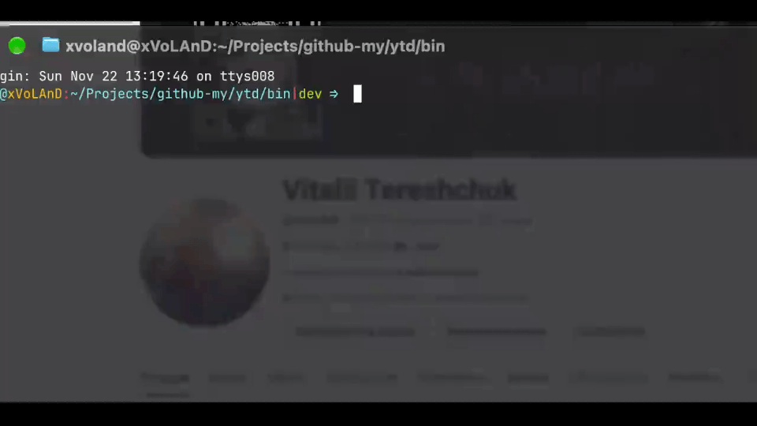

# YTD — CLI terminal video downloader with a live preview

`ytd` is a thin wrapper around [yt-dlp](https://github.com/yt-dlp/yt-dlp).
It downloads videos from the terminal and shows a thumbnail that **gains colour
as the download progresses**: it starts fully grayscale and reaches full colour
at 100%. The thumbnail is the progress indicator.

Homepage: https://dotoca.net/ytd


<p align="center">
<a href="https://dotoca.net/ytd">
		
  </a>
</p>

## How it works

1. `ytd` runs `yt-dlp -J --skip-download <your arguments>` to get the title,
   channel, duration, resolution and thumbnail URL — without downloading the
   video.
2. The thumbnail is fetched and resized to the reserved terminal area.
3. `yt-dlp` starts downloading with a custom
   `--progress-template`, so progress arrives as structured, machine-readable
   lines instead of a terminal progress bar.
4. **The image itself is the progress bar**: its coloured region grows from the
   left as the download advances, while the rest stays grayscale. In Kitty the new frame
   is transmitted with a fresh image ID and placed on top of the current one;
   only after that is the old ID deleted — no blank frame and no cursor
   movement. Text is updated line-by-line (`ESC[K` from the text column), so
   the image cells are never cleared. Kitty is used by default: `ytd` checks
   the terminal first and falls back to iTerm2 or ANSI text if the graphics
   protocol is not supported.
5. When the download finishes, a final full-colour frame is shown together with
   the output filename. **The image stays on screen** after `ytd` exits; only
   on a failed download is the card removed.

Everything that `ytd` does not recognise is passed to `yt-dlp` unchanged, so
all of yt-dlp's options, format selectors, cookies, proxies, etc. keep working.

## Requirements

- Go 1.25+ (to build from source)
- `yt-dlp` installed and available in `PATH` (or use `--ytdlp`)
- A terminal with image support is recommended; plain text works everywhere

## Installation

### Homebrew (macOS / Linux)

```bash
brew tap xvoland/ytd
brew trust xvoland/ytd   # one time: third-party taps are untrusted by default
brew install ytd
```

`brew trust` is required by Homebrew for any non-core tap; run it once per
machine. Without it Homebrew refuses to load the formula with
«Refusing to load formula ... from untrusted tap».

The formula builds from the tagged source and **ad-hoc signs the macOS binary**
(`codesign --force --timestamp=none --sign -`) at install time, then removes the
quarantine attribute. Gatekeeper therefore accepts it without the
«developer cannot be verified» prompt. `yt-dlp` is installed as a dependency.
Upgrade with `brew upgrade ytd`.

### Go

```bash
go install github.com/xvoland/ytd@latest
```

### Prebuilt binaries

Every `v*` tag triggers a release build with binaries for 10 platforms and a
`checksums.txt`. macOS binaries in the release are ad-hoc signed as well.

Or build locally:

```bash
./build.sh local     # produces ./bin/ytd
./bin/ytd --help
```

`./build.sh all` cross-builds every supported platform into `dist/`;
`./build.sh platforms` prints the OS/terminal support matrix.

## Usage

```bash
# Simple download
ytd https://youtu.be/VIDEO_ID

# Pick a format with any yt-dlp option
ytd -f 'bestvideo[height<=1080]+bestaudio/best' https://youtu.be/VIDEO_ID

# Use cookies from your browser
ytd --cookies-from-browser firefox https://youtu.be/VIDEO_ID

# Force the Kitty graphics protocol and a wider thumbnail
ytd --mode kitty --width 36 https://youtu.be/VIDEO_ID

# Progress card without a thumbnail
ytd --no-preview https://youtu.be/VIDEO_ID

# Use a yt-dlp binary from a non-standard location
ytd --ytdlp /usr/local/bin/yt-dlp https://youtu.be/VIDEO_ID
```

Use `--` to stop `ytd` from interpreting further arguments:

```bash
ytd -- https://youtu.be/VIDEO_ID --some-future-yt-dlp-flag
```

### CLI options

| Option | Environment | Default | Description |
|--------|-------------|---------|-------------|
| `--mode <name>` | `YTD_MODE` | `auto` | Renderer to use. See [Display modes](#display-modes) for every accepted value and the detection algorithm. |
| `--width <cells>` | `YTD_WIDTH` | auto | Thumbnail width in **terminal cells** (not pixels). Height is derived from the thumbnail aspect ratio. See [Image size](#image-size). |
| `--cell-width <n>` | `YTD_CELL_WIDTH` | `10` | Assumed pixel width of one terminal cell. Used only to rasterize the PNG sent to the terminal; it does not resize the terminal. |
| `--cell-height <n>` | `YTD_CELL_HEIGHT` | `20` | Assumed pixel height of one terminal cell. |
| `--no-preview` | — | off | Skip fetching the thumbnail entirely. The text card still shows title, metadata and progress; no image area is reserved. |
| `--ytdlp <path>` | `YTD_YTDLP` | `yt-dlp` | yt-dlp executable. Checked with `exec.LookPath` before anything else; may be an absolute path. |
| `--debug` | — | off | Log the exact metadata/download commands, thumbnail errors, timing, and print collected yt-dlp output after finishing. |
| `--version`, `-V` | — | — | Print version and copyright, then exit. |
| `--help`, `-h` | — | — | Print help (includes the copyright line) and exit. |
| `--` | — | — | Stop interpreting the remaining arguments as `ytd` options. |
| *anything else* | — | — | Forwarded to yt-dlp verbatim, in the original order. |

With no arguments `ytd` prints the version and copyright banner and exits with
status 1.

### Exit codes

| Code | Meaning |
|------|---------|
| `0` | Success |
| `1` | yt-dlp or other runtime failure (including Ctrl+C) |
| `2` | Usage error: no URL, or an invalid `ytd` option value |
| `127` | Required dependency (`yt-dlp`) not found |
| `130` | Interrupted with ESC or Ctrl+C (`128 + SIGINT`) |

Diagnostics go to stderr; the progress card and help/banner go to stdout.

Press **ESC** (or Ctrl+C) at any time during the download to interrupt it. The
terminal is briefly switched to raw mode while `ytd` runs so ESC is delivered
immediately; settings are restored before the `Cancelled by user` message and
any yt-dlp diagnostics are printed, so the output stays aligned. Arrow-key
escape sequences are ignored.

### Environment variables

Priority is always **explicit CLI flag > environment variable > built-in
default**. Environment variables are useful for a shell profile or a service:

```bash
export YTD_MODE=kitty
export YTD_WIDTH=36
export YTD_YTDLP=/opt/homebrew/bin/yt-dlp
```

| Variable | Accepted values | Effect |
|----------|-----------------|--------|
| `YTD_MODE` | `auto`, `kitty`, `tgp`, `iterm`, `iterm2`, `text`, `ansi`, `plain`, `none` | Same as `--mode`. Any other value behaves like `auto`. |
| `YTD_WIDTH` | whole number of cells (e.g. `36`) | Same as `--width`. A non-numeric value is ignored. |
| `YTD_YTDLP` | executable name or path | Same as `--ytdlp`. |
| `YTD_CELL_WIDTH` | positive integer | Same as `--cell-width`. |
| `YTD_CELL_HEIGHT` | positive integer | Same as `--cell-height`. |

## Display modes

`--mode` / `YTD_MODE` accepts the following values (aliases are equivalent):

| Value | Aliases | Renderer |
|-------|---------|----------|
| `auto` | *(default)* | Detect support and pick the best renderer, see below. |
| `kitty` | `tgp` | Kitty Terminal Graphics Protocol. Forced without probing. |
| `iterm` | `iterm2` | iTerm2 native inline images (`OSC 1337; File=...`). Forced without probing. |
| `text` | `ansi` | ANSI half-block characters (`▀`), 24-bit colour if `COLORTERM` contains `truecolor`/`24bit`, otherwise 256 colours. |
| `plain` | `none` | A single updating text line, no image. |

### How `auto` works

1. If stdout is not a TTY (pipe, log file, CI) → `plain`.
2. If `TERM_PROGRAM` is `Ghostty` or `WezTerm`, or `TERM=xterm-kitty`, or
   `KITTY_WINDOW_ID` is set → `kitty` immediately (no probe needed).
3. If `TERM_PROGRAM=iTerm.app` → probe Kitty support; on success use `kitty`,
   otherwise use iTerm2's native protocol.
4. Otherwise probe Kitty support; on success use `kitty`, otherwise `text`.

The probe sends a Kitty *query action* (`a=q,f=100,t=d` with a 1×1 PNG) to the
terminal and waits up to 400 ms for an `OK` acknowledgement. It does not store
an image or change what is on screen. Replies are read from `/dev/tty` on Unix
and `CONIN$` on Windows.

Forcing a mode skips detection: `--mode kitty` in a terminal without support
will print escape sequences that the terminal may display as garbage.

### Image size

- `--width` / `YTD_WIDTH` is measured in **terminal cells**, not pixels.
- If unset, the width is `term_columns / 3`, clamped to 20–34 cells (or
  `max(12, term_columns/2)` on narrow terminals), then limited to
  `term_columns - 4`.
- Height in rows is computed from the thumbnail's aspect ratio, clamped to
  5–14 rows and to `term_rows - 4`.
- `--cell-width` / `--cell-height` only control the pixel resolution of the
  PNG raster (default `10×20` px per cell). Increase them for a sharper image
  on a high-DPI display; decrease them to transmit less data.

```bash
ytd --width 36 --cell-width 12 --cell-height 24 https://youtu.be/VIDEO_ID
```

### Passing options to yt-dlp

`ytd` makes two yt-dlp calls: `yt-dlp -J --skip-download ...` for metadata, then
the actual download. Arguments that conflict with those calls (`--print`,
`-q`, `-o`, `--simulate`, JSON dump flags, etc.) are removed from the
corresponding invocation; everything else is passed through unchanged. `ytd`
appends its own `--progress`, `--newline`, `--color never` and
`--progress-template`, which take precedence. See [Troubleshooting](#troubleshooting)
if yt-dlp returns 403 — `ytd` retries once with an explicit player client.

### Rendering details

The thumbnail itself is the progress bar: the coloured region grows from the
left while the rest stays grayscale, with a subtle (25% brightness) white line
marking the boundary. Kitty updates use double buffering — a frame with a new
image ID is placed on top of the previous one, which is deleted only
afterwards, so there is no blank frame and no cursor movement (`C=1`). Text is
overwritten in place without `ESC[K` erase steps. When the download succeeds,
the final full-colour image stays on the screen; a failed download clears the
card instead.

## Troubleshooting

### `ERROR: unable to download video data: HTTP Error 403: Forbidden`

YouTube sometimes rejects the CDN URL for the selected format. This is a
`yt-dlp`/YouTube issue, not a rendering problem. Retry, or give yt-dlp a fresh
player client or your browser cookies:

```bash
ytd --extractor-args 'youtube:player_client=web' https://youtu.be/VIDEO_ID
ytd --cookies-from-browser firefox https://youtu.be/VIDEO_ID
```

## Releases and Homebrew

Pushing a `v*` tag triggers `.github/workflows/build.yml`. It builds all ten
targets, ad-hoc signs the macOS binaries (`codesign --force --timestamp=none
--sign -`), refreshes `checksums.txt` afterwards, and attaches every binary to
a GitHub Release. Pushes to `master` run the build without creating a release.

The `update-tap` job updates `url`, `sha256` and `version` in
[`Formula/ytd.rb`](https://github.com/xvoland/homebrew-ytd/blob/main/Formula/ytd.rb)
in the `xvoland/homebrew-ytd` tap on every `v*` tag push. The formula signs the
binary with `codesign --sign -` and strips quarantine via `xattr -dr
com.apple.quarantine` after building, so Homebrew installs an accepted binary
without extra user steps. The job needs the `TAP_TOKEN` secret and never fails
the release.

## Development

```bash
./build.sh test       # go test ./...
./build.sh local      # build ./bin/ytd with the current git tag
./build.sh all        # cross-build all targets + checksums
./build.sh platforms  # supported OS/terminal matrix
gofmt -w *.go
```

`./build.sh` embeds `git describe --tags` into `ytd --version`; a plain
`go build` reports `x.x.x (local)`.

### Benchmarks

```bash
./build.sh bench                 # COUNT=10, writes bench.txt
benchstat bench.txt              # statistical summary
```

The hot path is the per-frame image update. Reference numbers
(Apple M2 Pro, darwin/arm64, `-benchmem -count=10`, `benchstat`):

| Benchmark | sec/op | B/op | allocs/op |
|-----------|--------|------|-----------|
| `ApplyProgressWipe/w=240` | 50.7µ ± 1% | 88.1 KiB | 2 |
| `KittyTransmit` (encoding every call) | 714.4µ ± 0% | 1.07 MiB | 29 |
| `KittyTransmitCached` (real hot path) | 117.3n ± 2% | 132 B | 2 |
| `ITermPlace` (encoding every call) | 720.4µ ± 0% | 1.06 MiB | 26 |
| `RenderHalfBlocks` | 222.3µ ± 0% | 85.3 KiB | 78 |
| `ParseProgressLine` | 322.8n ± 0% | 192 B | 2 |
| `ProgressTrackerUpdate` | 52.1n ± 0% | 0 B | 0 |

Per-frame encoding is avoided on the hot path: the wipe is cached by whole
percent (at most 101 frames, ~4 KB each), so a repeated frame costs ~117 ns and
132 B instead of ~714 µs and 1 MiB. A new percent still pays one encoding, i.e.
at most ~72 ms of encoding work spread across an entire download.

## Copyright

```
(c) 2026, Vitalii Tereshchuk / xVoLAnD (https://dotoca.net). All rights reserved.
```

